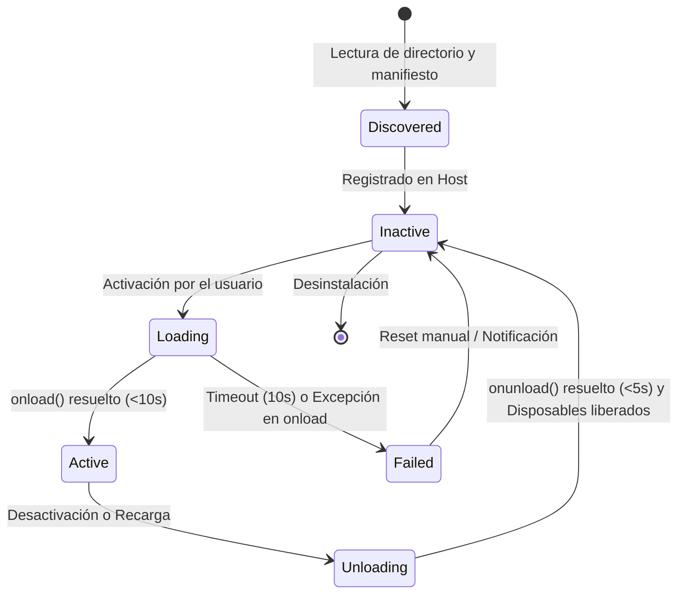

# RFC-0001: Arquitectura de la API de Plugins de IndexLy Desktop (v1)

- **Estado:** Propuesta (Fase 0 — Diseño)
- **Fecha:** 2026-10-30
- **Autores:** Equipo de Arquitectura de Plataforma, DX, Calidad, TypeScript/React y Rust/Tauri
- **Feature Flag:** `plugin_api_v1`
- **Rama:** `feat/plugin-api-v1`
- **Versión de API Host:** `1.0.0`

---

## 1. Resumen Ejecutivo y Contexto

IndexLy Desktop es una aplicación de alto rendimiento para catalogación, búsqueda instantánea (SQLite FTS5) e indexación universal desarrollada con Tauri v2 y React 19. Su motor de extensibilidad previo ("Co-Kernel v3", centrado en `PluginRegistry.ts` y el global `window.IndexLy`) permitió una rápida experimentación pero carece de un contrato formal de estabilidad, aislamiento de fallos, gestión determinista del ciclo de vida y tipado canónico exportable.

Este RFC define la especificación definitiva para la **API de Plugins v1**, adoptando formalmente el **Modelo Obsidian**. La API establece un contrato permanente, tipado de primera clase sin dependencias ambiguas, ciclo de vida con limpieza garantizada (teardown libre de fugas de memoria), superficie nativa de bajo nivel (`app.native`) gobernada mediante comandos Tauri tipados y un plan riguroso de migración que preserva compatibilidad absoluta con plugins existentes (v1–v3) y subsana la deuda técnica del motor base.

---

## 2. Modelo de Confianza (Trust Model)

### 2.1 Filosofía Obsidian vs Sandbox Ilusorio
En herramientas de productividad y gestión de conocimiento local avanzadas (Obsidian, VS Code, Raycast), los usuarios y desarrolladores requieren acceso fluido y de alto rendimiento al sistema de archivos local, bases de datos SQLite nativas, procesos del sistema operativo e interactividad con el DOM del motor web.

**Decisión vinculante:**
1. **Mismo runtime:** Los plugins se ejecutan directamente en el contexto V8/WebView2 de la aplicación principal. No se utilizan iframes, Web Workers aislados ni procesos Node.js secundarios para alojar el código UI del plugin.
2. **Acceso irrestricto:** El plugin posee acceso total al grafo `app.*`, a comandos nativos mediante `app.native` y al DOM dentro de su contenedor designado.
3. **Rechazo a sandboxes cosméticos:** No se implementan sistemas de permisos restrictivos a nivel de código que simulen contener al plugin mientras comparten el mismo contexto de memoria. Fingir seguridad técnica genera una falsa sensación de protección y penaliza severamente el rendimiento y la flexibilidad.

### 2.2 Rol de los Permisos del Manifiesto
El campo `permissions` en `manifest.json` (`fs:read`, `net:http`, `process:spawn`, `db:exec`, etc.) opera como un **contrato informativo y de transparencia**:
- Durante la instalación o actualización desde el Hub o paquete local, la UI presenta al usuario un desglose detallado de los permisos declarados.
- Si una actualización introduce permisos adicionales, el host suspende la auto-actualización y solicita consentimiento explícito al usuario.
- Los permisos sirven como metadato de auditoría estática y escaneo automatizado en el Hub.

### 2.3 Seguridad Social, Revisión y Modo Restringido
- **Activación Explícita (Opt-In):** Ningún plugin recién instalado se activa automáticamente; requiere acción voluntaria del usuario.
- **Modo Restringido (Restricted Mode):** Estado de arranque seguro global en el que ningún plugin de terceros es ejecutado. Ideal para depuración y recuperación de fallos.
- **Protección contra Bloqueos de Arranque (Crash Recovery):** Si IndexLy detecta 2 cierres anormales o cuelgues consecutivos en el arranque, se inicia automáticamente en Modo Restringido, notificando la anomalía y ofreciendo reactivar extensiones de forma individual.
- **Escaneo Preventivo:** El Hub ejecuta análisis estático de dependencias (AST parsing) para detectar patrones maliciosos evidentes (ofuscación extrema, llamadas dinámicas a endpoints sospechosos, manipulación indebida de credenciales).

---

## 3. Grafo de la API Pública v1

Toda la superficie de interacción del host se organiza bajo el paquete npm canónico `@indexly/plugin-api` (distribuido como `indexly`).

```mermaid
graph TD
    App["app: App (Host Root)"] --> Library["app.library (Fuentes & Items)"]
    App --> Search["app.search (FTS5 & Streaming)"]
    App --> Workspace["app.workspace (Hojas, Vistas, Ribbon)"]
    App --> Commands["app.commands (Paleta & Atajos)"]
    App --> Settings["app.settings (Ajustes de Host & Plugins)"]
    App --> Importer["app.importer (Pipelines de Importación)"]
    App --> Hub["app.hub (Gestión de Extensiones)"]
    App --> Native["app.native (Tauri IPC de bajo nivel)"]
    App --> Events["app.events (Bus de Eventos Namespaced)"]
    App --> Storage["app.storage (Almacenamiento Aislado en Disco)"]
    App --> UI["app.ui (Modales, Settings, Contenedores)"]
    App --> Legacy["app.legacy (Adaptador retrocompatible v1-v3)"]
```



### 3.1 Interfaz Central `App`
```ts
export interface App {
  readonly version: string;          // p. ej. "1.0.0"
  readonly apiVersion: string;       // "1.0.0"
  readonly features: FeatureSet;     // Detección de capacidades en tiempo de ejecución
  readonly library: LibraryApi;      // Fuentes, colecciones e items
  readonly search: SearchApi;        // Búsqueda local FTS5, streaming y proveedores
  readonly workspace: WorkspaceApi;  // Ventanas, vistas, ribbon, barra de estado
  readonly commands: CommandsApi;    // Comandos de paleta, menú contextual
  readonly settings: SettingsApi;    // Registro de pestañas de configuración y persistencia
  readonly importer: ImporterApi;    // Extensiones del motor de importación
  readonly hub: HubApi;              // Catálogo, instalación y actualización de plugins
  readonly native: NativeApi;        // Puente de capacidades nativas del SO
  readonly events: EventsApi;        // Bus de eventos tipados desacoplado
  readonly storage: StorageApi;      // Persistencia local atómica por plugin
  readonly ui: UiApi;                // Primitivas de interfaz (Modal, Setting, Notice)
  readonly legacy: LegacyApi;        // window.IndexLy retrocompatible (deprecado)
}
```

### 3.2 Clase Base `Plugin` y Jerarquía de Componentes
Los plugins heredan de la clase base `Plugin`. Todas las suscripciones, comandos, vistas y elementos DOM registrados a través de métodos helper quedan enlazados a la instancia y se desregistran de forma automática e inversa en `onunload()`:

```ts
export abstract class Plugin extends Component {
  public readonly app: App;
  public readonly manifest: PluginManifest;

  constructor(app: App, manifest: PluginManifest) {
    super();
    this.app = app;
    this.manifest = manifest;
  }

  // Ciclo de vida principal
  abstract onload(): void | Promise<void>;
  onunload(): void | Promise<void>;

  // Registro declarativo reversible
  addCommand(cmd: Command): Command;
  addRibbonIcon(icon: string, title: string, callback: (ev: MouseEvent) => unknown): HTMLElement;
  addStatusBarItem(): HTMLElement;
  addSettingTab(tab: PluginSettingTab): void;
  registerView(type: string, factory: (leaf: WorkspaceLeaf) => View): void;
  registerEvent(ref: EventRef): void;
  registerDomEvent<K extends keyof HTMLElementEventMap>(
    element: HTMLElement | Window | Document,
    type: K,
    callback: (ev: HTMLElementEventMap[K]) => unknown,
    options?: boolean | AddEventListenerOptions
  ): void;
  registerInterval(id: number): number;
  register(teardownCallback: () => unknown): void;

  // Persistencia de configuración
  loadData<T = unknown>(): Promise<T | null>;
  saveData(data: unknown): Promise<void>;
}
```

### 3.3 Módulos de Dominio

#### `app.library`
- `getSources(): Promise<Source[]>`
- `getSource(id: string): Promise<Source | null>`
- `addSource(input: AddSourceInput): Promise<Source>`
- `updateSource(id: string, patch: Partial<Source>): Promise<Source>`
- `removeSource(id: string): Promise<void>`
- `getItems(query: LibraryQuery): Promise<UnifiedItem[]>`
- `getItem(id: string): Promise<UnifiedItem | null>`
- `on(event: 'source:added' | 'source:updated' | 'source:removed' | 'items:changed', cb: EventCallback): EventRef`

#### `app.search`
- `query(q: string, opts?: SearchOptions): Promise<SearchResults>`
- `queryStream(q: string, opts?: SearchOptions): AsyncIterable<SearchHit>` (con soporte de `AbortSignal` y cancelación cooperativa)
- `registerProvider(provider: SearchProvider): void`
- `unregisterProvider(id: string): void`
- `reindex(sourceId?: string): Promise<void>`
- `on(event: 'query:before' | 'query:after', cb: EventCallback): EventRef`

#### `app.workspace`
- `getActiveWindow(): WindowInfo`
- `getWindows(): WindowInfo[]`
- `getLeaves(): WorkspaceLeaf[]`
- `getLeaf(type?: string): WorkspaceLeaf`
- `revealLeaf(leaf: WorkspaceLeaf): void`
- `detachLeavesOfType(type: string): void`
- `onLayoutReady(callback: () => void): void`
- `openSpotlight(): Promise<void>`
- `on(event: 'layout-change' | 'window:open' | 'window:close', cb: EventCallback): EventRef`

#### `app.commands`
- `addCommand(command: Command): Command`
- `removeCommand(id: string): void`
- `executeCommand(id: string, ...args: unknown[]): Promise<boolean>`
- `listCommands(): Command[]`
- `addContextMenuItem(item: ContextMenuItem): EventRef`

#### `app.settings`
- `registerSection(section: SettingSection): void`
- `registerTab(tab: PluginSettingTab): void`
- `get<T = unknown>(key: string, defaultValue?: T): Promise<T>`
- `set(key: string, value: unknown): Promise<void>`
- `onChange(keyOrCb: string | ((key: string, val: unknown) => void), cb?: (val: unknown) => void): EventRef`

#### `app.importer`
- `registerImporter(importer: CustomImporter): EventRef`
- `importFile(pathOrContent: string, opts?: ImportOptions): Promise<Source[]>`
- `on(event: 'import:progress', cb: (p: ImportProgress) => void): EventRef`

#### `app.hub`
- `search(query: string): Promise<HubPluginSummary[]>`
- `getPlugin(id: string): Promise<HubPluginDetail | null>`
- `install(id: string, version?: string): Promise<void>`
- `update(id: string): Promise<void>`
- `uninstall(id: string): Promise<void>`
- `listInstalled(): LoadedPluginInfo[]`

#### `app.events`
- `on(event: string, callback: EventCallback): EventRef`
- `off(ref: EventRef): void`
- `emit(event: string, payload?: unknown): void` (con namespaces seguros: `plugin-id:event-name` o eventos públicos del host)

#### `app.storage`
- `pluginDataDir(id: string): Promise<string>`
- `readJson<T = unknown>(filename: string): Promise<T | null>`
- `writeJson(filename: string, data: unknown): Promise<void>` (escritura atómica con archivo temporal y reemplazo transaccional)
- `readText(filename: string): Promise<string>`
- `writeText(filename: string, content: string): Promise<void>`
- `remove(filename: string): Promise<void>`

#### `app.ui`
- Clases componentes: `Modal`, `PluginSettingTab`, `Setting`, `Notice`, `Menu`, `SuggestModal`, `FuzzySuggestModal`, `ItemView`.
- Helpers de tema: `getTheme(): 'dark' | 'light'`, `onThemeChange(cb: (theme: string) => void): EventRef`.

---

## 4. Superficie Nativa (`app.native`)

`app.native` proporciona acceso completo al sistema operativo a través de comandos IPC fuertemente tipados en Rust:

```ts
export interface NativeApi {
  invoke<T = unknown>(cmd: string, args?: Record<string, unknown>): Promise<T>;
  fs: {
    read(path: string): Promise<Uint8Array>;
    readText(path: string): Promise<string>;
    write(path: string, data: Uint8Array | string): Promise<void>;
    readDir(path: string): Promise<DirEntry[]>;
    mkdir(path: string, opts?: { recursive?: boolean }): Promise<void>;
    remove(path: string, opts?: { recursive?: boolean }): Promise<void>;
    rename(from: string, to: string): Promise<void>;
    stat(path: string): Promise<FileStat>;
    watch(path: string, cb: (ev: WatchEvent) => void): Promise<() => void>;
  };
  path: {
    join(...parts: string[]): string;
    resolve(...parts: string[]): string;
    dirname(p: string): string;
    basename(p: string): string;
    extname(p: string): string;
    appData(): Promise<string>;
    appConfig(): Promise<string>;
    home(): Promise<string>;
    temp(): Promise<string>;
    sep: string;
  };
  process: {
    spawn(cmd: string, args?: string[], opts?: SpawnOptions): Promise<ChildHandle>;
    exec(cmd: string, opts?: ExecOptions): Promise<{ code: number; stdout: string; stderr: string }>;
    kill(pid: number): Promise<void>;
    env(): Promise<Record<string, string>>;
    cwd(): Promise<string>;
  };
  net: {
    fetch(input: string | Request, init?: RequestInit): Promise<Response>;
    download(url: string, dest: string, onProgress?: (n: number) => void): Promise<void>;
    listen(port: number, cb: (req: unknown) => void): Promise<() => void>;
  };
  shell: {
    openPath(p: string): Promise<void>;
    openUrl(u: string): Promise<void>;
    showInFolder(p: string): Promise<void>;
  };
  clipboard: {
    readText(): Promise<string>;
    writeText(s: string): Promise<void>;
    readImage(): Promise<Uint8Array | null>;
    writeImage(b: Uint8Array): Promise<void>;
  };
  notifications: {
    send(opts: { title: string; body?: string; icon?: string }): Promise<void>;
  };
  tray: {
    create(opts: TrayOptions): Promise<TrayHandle>;
    update(h: TrayHandle, opts: Partial<TrayOptions>): Promise<void>;
    remove(h: TrayHandle): Promise<void>;
  };
  shortcuts: {
    register(accel: string, cb: () => void): Promise<() => void>;
    unregister(accel: string): Promise<void>;
  };
  windows: {
    create(opts: WindowOptions): Promise<WindowHandle>;
    list(): Promise<WindowInfo[]>;
    focus(id: string): Promise<void>;
    close(id: string): Promise<void>;
  };
  os: {
    platform(): 'windows' | 'macos' | 'linux';
    arch(): string;
    version(): Promise<string>;
    locale(): string;
  };
  keychain: {
    get(key: string): Promise<string | null>;
    set(key: string, value: string): Promise<void>;
    delete(key: string): Promise<void>;
  };
  db: {
    query<T = unknown>(sql: string, params?: unknown[]): Promise<T[]>;
    exec(sql: string): Promise<void>;
  };
}
```

### Reglas críticas de seguridad operativa para `app.native`:
1. **Acceso a Base de Datos (`native.db`):** Expuesta en modo de **solo lectura** de forma predeterminada mediante una conexión SQLite separada sin privilegios de escritura (`PRAGMA query_only = ON`). La ejecución de sentencias de escritura (`exec`) requiere que el plugin declare `"permissions": ["db:write"]` en su manifiesto y que el usuario lo apruebe expresamente durante la instalación o actualización.
2. **Gestión de Secretos (`native.keychain`):** Utiliza el llavero seguro nativo del sistema operativo (Windows Credential Manager, macOS Keychain, Secret Service API en Linux). Queda expresamente prohibido almacenar tokens de autenticación o secretos en `localStorage` o `data.json`.
3. **Manejo de Errores Tipados:** Todo fallo nativo en Rust devuelve un error descriptivo con código estructurado (`IOError`, `ProcessError`, `DatabaseLocked`, `KeychainError`), previniendo caídas no controladas del hilo JavaScript.

---

## 5. Ciclo de Vida y Prevención de Fugas de Memoria

### 5.1 Fases del Ciclo de Vida


### 5.2 Garantías de Limpieza LIFO
1. **Desmontaje Inverso:** Todas las operaciones `register*`, `addCommand`, `addRibbonIcon`, `addStatusBarItem`, `registerView` y listeners DOM se almacenan en una lista de descarte (`disposables`). Al descargar el plugin, se ejecutan en **orden LIFO estricto** (último registrado, primero eliminado).
2. **Timeouts Inquebrantables:**
   - `onload()` cuenta con un tiempo límite de **10 segundos**. Si no resuelve o rechaza, el plugin se desactiva de inmediato y se añade un registro de incidente al panel de errores.
   - `onunload()` cuenta con un tiempo límite de **5 segundos**. Si el hook del plugin no finaliza, el host procede forzosamente a purgar todos sus listeners DOM, hojas de vista abiertas, estilos CSS inyectados y atajos globales.
3. **Prueba Obligatoria de Cero Fugas (Leak Test Suite):**
   - La suite de integración cargará y descargará cada plugin 100 veces consecutivas en un entorno controlado con jsdom/navegador.
   - Tras los 100 ciclos, el recuento de nodos DOM huérfanos, intervalos activos (`activeIntervalsCount`), listeners de eventos y suscripciones a Tauri IPC debe ser exactamente idéntico al estado previo a la prueba.

---

## 6. Runtime de Plugins (`PluginHost`)

### 6.1 Estructura del Bundle
Cada plugin se almacena en su propio directorio dentro de `<appDataDir>/plugins/<pluginId>/`:
- `manifest.json`: Metadatos, versión mínima, permisos y puntos de extensión.
- `main.js`: Código ejecutable compilado en formato CommonJS (CJS).
- `styles.css` (opcional): Estilos aislados.
- `data.json` (opcional): Ajustes persistentes creados por `saveData()`.

### 6.2 Cargador CJS y Entorno de Aislamiento
El cargador evalúa `main.js` mediante:
```ts
const moduleFn = new Function('module', 'exports', 'require', pluginCode);
```
El parámetro `require` intercepta todas las peticiones con una lista de permitidos rígida:
- Si solicita `'indexly'`, devuelve el objeto `app` y las clases base (`Plugin`, `Modal`, `Setting`, etc.).
- Si solicita utilidades puras (`'path'`, `'os'`), resuelve implementaciones seguras controladas.
- Cualquier otra llamada a `require('cualquier-paquete')` arroja una excepción explícita indicando que las dependencias deben empaquetarse en el bundle (`bundle in main.js`) y proporciona un enlace a la documentación.

### 6.3 Aislamiento de Fallos y Safe Execution
- **`safeCall(pluginId, fn, context)`:** Todas las invocaciones originadas en callbacks de plugins (eventos, atajos, comandos, renders de vista) están encapsuladas con captura de excepciones. Un error en un plugin **nunca interrumpe el bucle de eventos ni crashea el host**.
- **Detección de Bloqueo de Hilo:** El host monitoriza el tiempo de ejecución síncrono mediante `performance.now()`. Si un callback retiene el hilo principal durante más de **250 ms**, se emite un aviso de diagnóstico en consola y telemetría local.
- **Protección ante Bucles de Fallo:** Si un plugin acumula más de 10 errores no controlados en menos de 5 minutos, el host suspende temporalmente el plugin, emite un aviso en la UI y ofrece la opción de desactivarlo permanentemente o reportar el fallo.

### 6.4 Arranque Escalonado y Modo Desarrollador
- **Carga Escalonada:** Los plugins no bloquean el render inicial de la ventana principal. Se inician en serie tras el evento `onLayoutReady`, reservando una pausa de **50 ms** entre cada carga para permitir la interactividad fluida del usuario.
- **Hot Reload (Dev Mode):** Supervisión en tiempo real de la carpeta `plugins-dev/`. Cualquier modificación en `main.js` o `styles.css` ejecuta automáticamente una secuencia `onunload() -> purge -> reload -> onload()` sin recargar la aplicación completa.

---

## 7. Contrato de Estabilidad e Inmutabilidad

Para asegurar que un plugin desarrollado hoy continúe funcionando inalterado durante años:

1. **SemVer de API Host:** `apiVersion` arranca en `1.0.0`. En toda la serie `1.x.y` solo se admiten cambios estrictamente **aditivos**.
2. **Núcleo Inmutable:** Las firmas fundamentales (`App`, `Plugin`, `Component`, `EventRef`, `Command`, `View`, `WorkspaceLeaf`, `PluginManifest`) quedan formalmente congeladas.
3. **Deprecación con Garantía de 12 Meses:** Si un método requiere reemplazo, se conserva operativo emitiendo una única advertencia por sesión (`@deprecated`) y se garantiza su existencia durante un periodo mínimo de 12 meses antes de cualquier revisión mayor.
4. **Detección de Características:** Plugins pueden verificar capacidades dinámicas mediante:
   ```ts
   if (app.features.has('search.stream')) { ... }
   ```
5. **Comprobación de Compatibilidad (`minHostVersion`):** Si la versión de IndexLy instalada es inferior a la requerida por el manifiesto, el plugin no se carga y se expone un mensaje claro al usuario indicando la actualización necesaria.
6. **Snapshot de API en CI con `@microsoft/api-extractor`:**
   - La superficie pública genera un archivo de referencia `api/indexly.api.md`.
   - Cualquier cambio incompatible o eliminación accidental provoca el fallo inmediato del pipeline de integración continua.
7. **Suite de Conformidad `@indexly/plugin-test-kit`:** Paquete de pruebas que los autores de plugins pueden ejecutar localmente para validar ciclo de vida, registros y ausencia de fugas de memoria.
8. **Plugins de Prueba de Regresión Continua:** En el repositorio se mantienen 3 plugins representativos (`hello-command`, `custom-view-react`, `importer-csv`). El CI compila y ejecuta estos tres plugins contra cada commit. Si la API sufre una regresión, los ejemplos fallan.

---

## 8. Plan de Migración desde el Co-Kernel Actual

### 8.1 Adaptador Retrocompatible (`app.legacy` y `window.IndexLy`)
Para no romper extensiones existentes (ReadLy, Vistas, plugins comunitarios iniciales):
- `window.IndexLy` se mantiene como un proxy hacia `app.legacy`.
- Métodos como `IndexLy.register()`, `IndexLy.plugin()`, `IndexLy.addSection()`, `IndexLy.addCardAction()`, `IndexLy.pipeline.intercept()` y `IndexLy.native.*` siguen operativos, redirigiendo internamente a las nuevas primitivas de `app.*` mientras registran una advertencia de deprecación en la consola del desarrollador.

### 8.2 Resolución de Deuda Técnica y Corrección de Bugs Vinculantes
Durante la implementación del nuevo host se subsanan de forma definitiva los 11 problemas detectados en el motor previo:

| # | Bug / Limitación Existente | Solución en la API v1 |
|---|---------------------------|-----------------------|
| 1 | Debounce de búsqueda de 25 ms sin cancelación de peticiones | Debounce configurable con cancelación explícita mediante `AbortController` y token de solicitud en vuelo. |
| 2 | `ORDER BY file_size` textual en SQLite | Almacenamiento numérico en bytes (`file_size_bytes INTEGER`) e índice optimizado; formato textual solo para presentación. |
| 3 | Sanitizador FTS5 rudimentario | Tokenizador y escapado robusto para consultas FTS5 que maneja comillas, comodines y operadores lógicos sin provocar syntax errors. |
| 4 | `addSource` ignoraba claves camelCase | Inclusión de `#[serde(rename_all = "camelCase")]` y alias en `MappingConfig` en Rust. |
| 5 | `insert_sources_batch` omitía `flags_json` | Inclusión del campo `flags_json` en la consulta `INSERT` por lotes de `db.rs`. |
| 6 | Mapping CSV no aplicado en normalizador | Paso explícito de `MappingConfig` a `parse_csv_to_items` e indexación de columnas personalizadas. |
| 7 | Importación tabular `{k, v}` producía 0 items fuera de v2 envelope | Detección automática del patrón tabular en `normalize_json_to_items` para archivos JSON independientes. |
| 8 | `.torrent` generaba enlaces magnet sintéticos | Extracción e indexación real del info_hash y metadata bencoded del archivo torrent. |
| 9 | Guard `dataset.rendered` en `Slot.tsx` bloqueaba re-render | Refactorización de `Slot.tsx` con referencias de montaje limpias y callbacks de limpieza devueltos por `render()`. |
| 10 | Vistas custom limpiaban el DOM en cada render | Contenedor persistente gestionado por el plugin; el host solo notifica cambios de contexto sin vaciar `innerHTML`. |
| 11 | Ventana Spotlight sin permisos en `default.json` | Declaración de la ventana `"spotlight"` en las capacidades de Tauri (`src-tauri/capabilities/default.json`). |
| 12 | `ensure_bundled_plugins` con ruta absoluta hardcodeada | Detección dinámica de la ruta de recursos de la aplicación (`app_handle.path().resource_dir()`). |

---

## 9. Matriz de Riesgos y Mitigaciones

| Riesgo | Impacto | Probabilidad | Estrategia de Mitigación |
|--------|---------|--------------|--------------------------|
| Plugin bloquea el hilo UI con bucles síncronos pesados | Alto | Media | Monitoreo con `performance.now()`; advertencias en consola (>250ms); recomendación de `app.native.process.spawn` o `Worker` interno para tareas intensivas. |
| Fuga de memoria por listeners huérfanos tras recarga | Alto | Media | Registro LIFO forzoso en `Plugin`; suite de tests con 100 ciclos de recarga continua en CI. |
| Bloqueo de base de datos SQLite por queries de larga duración | Crítico | Baja | Conexión separada en modo solo lectura (`PRAGMA query_only = ON`) para `app.native.db`; timeouts en transacciones. |
| Plugin malicioso intenta sobreescribir métodos del host | Alto | Baja | Congelamiento de interfaces con `Object.freeze()` en el objeto `app` público y aislamiento de prototipos en el loader. |
| Incompatibilidad de plugins desarrollados en versiones anteriores | Medio | Baja | Adaptador completo `app.legacy` que emula `window.IndexLy` con cobertura de pruebas de regresión. |

---

## 10. Decisión y Pasos Siguientes

Este RFC formaliza el diseño arquitectónico de la plataforma de extensiones de IndexLy Desktop. 

**Requisito de parada:** Este documento permanece a la espera de revisión y aprobación formal del usuario antes de proceder con cualquier cambio de código en la Fase 1.
