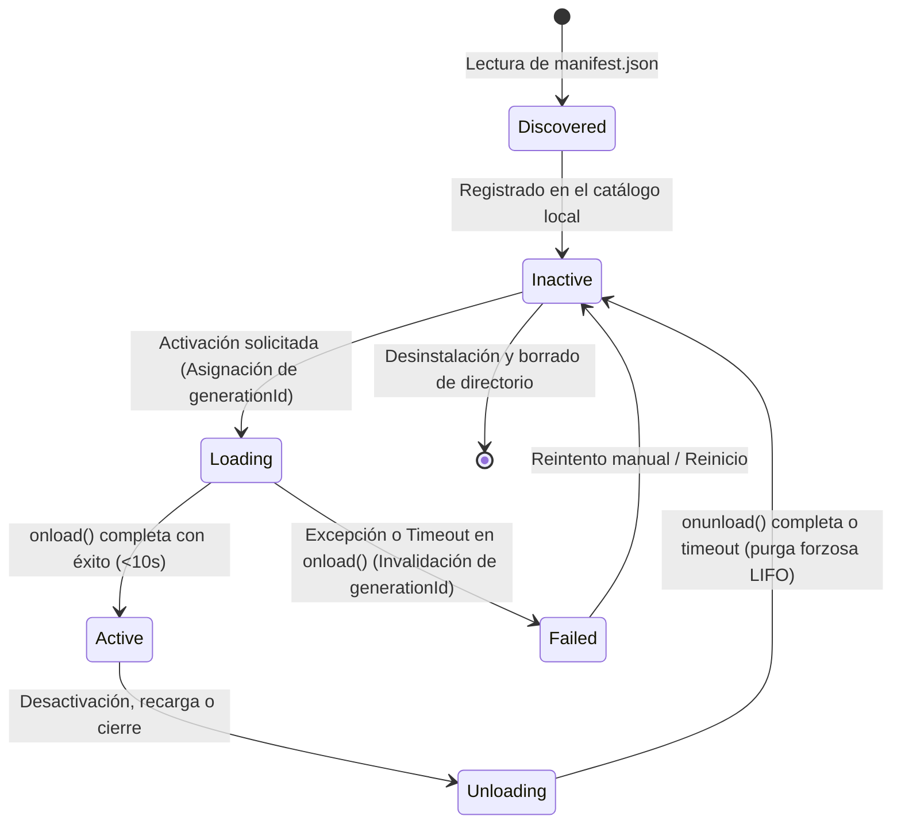

# Ciclo de Vida, Prevención de Fugas y Token de Generación

Este documento describe la máquina de estados, el protocolo de carga/descarga, la semántica realista de timeouts frente a las limitaciones de V8 y la instrumentación rigurosa del harness de pruebas contra fugas de memoria.

---

## 1. Máquina de Estados del Plugin



`PluginHost` serializa las operaciones de un mismo plugin (`enable`, `disable`, `reload`)
para que dos activaciones concurrentes no creen dos instancias ni dupliquen listeners.
Plugins distintos pueden cargarse en paralelo.

---

## 2. Semántica de Timeouts y Token de Generación

### 2.1 Limitaciones de V8 y Código Síncrono
En el modelo de concurrencia de JavaScript basado en un único hilo con bucle de eventos, **ningún temporizador ni interrupción externa de software puede abortar de forma segura un bucle síncrono infinito** (`while(true)`). 

Por tanto, el `PluginHost` adopta un enfoque realista:
1. **Medición de Bloqueo Síncrono:** Todas las fases de ejecución de plugins son medidas con `performance.now()`. Si una llamada síncrona retiene el hilo más de **250 ms**, se emite una alerta diagnóstica. Si supera 10 segundos continuos, el watchdog del sistema operativo alertará al usuario y forzará el Modo Seguro en el siguiente arranque.
2. **Promesas Asíncronas:** Para operaciones asíncronas (`onload()`, `onunload()`), el host establece una carrera (`Promise.race`) contra un temporizador interno:
   - `onload()`: 10 segundos.
   - `onunload()`: 5 segundos.

### 2.2 Token de Generación (`generationId`)
Para evitar que un plugin cuyo `onload()` sufrió un timeout quede marcado como cargado o deje recursos huérfanos cuando finalmente resuelve tarde (problema del plugin zombi):
1. Cada ciclo de carga genera un número de versión `generationId` monótonamente creciente en el host.
2. La instancia del plugin recibe este `generationId`.
3. Al completar `onload()`, el host comprueba `generationManager.isValid(id, generationId)`. Si fue invalidado (timeout, descarga o recarga), limpia la instancia y no la marca como activa.
4. Al dispararse un timeout o al iniciar la descarga, el `generationId` se invalida de inmediato. Si el `onload()` tardío termina después, el host ejecuta una segunda limpieza idempotente de los recursos que haya registrado.
5. **Limitación actual:** las APIs de registro (`addCommand`, `registerView`, etc.) no comprueban el `generationId` en cada llamada. La protección es de ciclo de vida (no marcar activo y limpiar tarde), no un filtro por llamada.

---

## 3. Atribución de Errores Globales

Cuando se produce un error no capturado en la aplicación, el host lo atribuye al plugin exacto mediante una estrategia triple:

1. **Virtual Source URLs:** Todo código evaluado por el loader inyecta al final:
   ```js
   //# sourceURL=indexly-plugin://${manifest.id}/main.js
   ```
2. **Stack Trace Parsing:** Los manejadores globales `window.onerror` y `window.onunhandledrejection` analizan el `error.stack`. Si la pila contiene `indexly-plugin://${manifest.id}/`, el error se adjudica inequívocamente a ese plugin.
3. **Pila de Contexto (`safeCall`):** Durante la invocación de callbacks registrados (eventos, atajos, comandos), el host establece `activePluginContext = pluginId` en un stack síncrono. Los callbacks diferidos capturan esta etiqueta para mantener la trazabilidad.

---

## 4. Verificación de Fugas en la Suite Local

**No existe un paquete publicado `@indexly/plugin-test-kit` ni un harness con `WeakRef`/`FinalizationRegistry`.** La verificación real se apoya en pruebas de Vitest con `jsdom`:

- `src/plugins/__tests__/PluginHost.test.ts`: comprueba que, tras `disablePlugin()`, se eliminan comandos y elementos de ribbon registrados, y que los estilos `<style data-plugin-id="...">` se retiran.
- `src/plugins/__tests__/SamplePlugins.test.ts`: ejecuta plugins reales y verifica su limpieza tras `onunload()`.
- `Component.unload()` ejecuta los disposables en orden LIFO y es idempotente.

### Protocolo real (limitado)
1. **Comandos y DOM:** se consulta `sharedCommands.listCommands()` y el DOM tras la descarga.
2. **Estilos:** se verifica la ausencia de etiquetas `<style>` asociadas al plugin.
3. **Eventos:** `HostEventsApi.purgePlugin(id)` elimina los listeners del plugin.
4. **No verificado hoy:** recolección de basura real, listeners DOM añadidos manualmente por el plugin fuera de `Component`, y pares `listen/unlisten` de Tauri. Son áreas de mejora, no garantías existentes.
