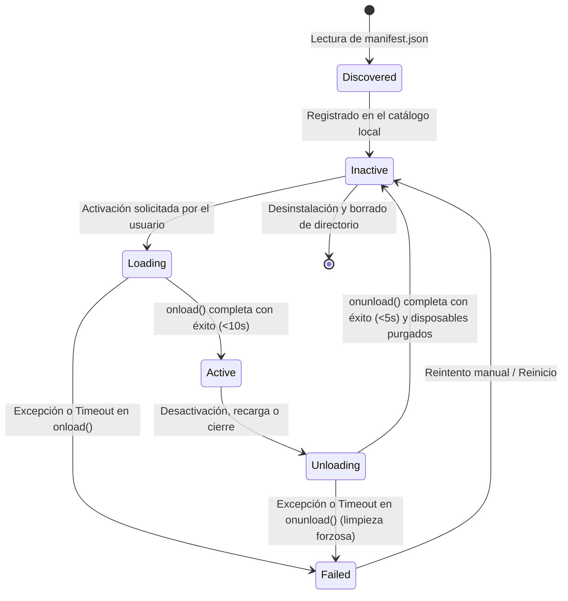

# Ciclo de Vida y Prevención de Fugas de Memoria

Este documento describe la máquina de estados, el protocolo de carga/descarga y los requisitos de limpieza estricta implementados en el **PluginHost** de IndexLy Desktop.

---

## 1. Máquina de Estados del Plugin



---

## 2. Semántica de los Métodos del Ciclo de Vida

### 2.1 `onload(): void | Promise<void>`
- Se ejecuta inmediatamente después de que el archivo `main.js` ha sido evaluado en memoria por el cargador.
- El plugin debe utilizar este hook para inicializar servicios, registrar comandos, vistas y suscribirse a eventos.
- **Timeout de 10 segundos:** Si la promesa devuelta por `onload()` tarda más de 10.000 ms en resolverse, el `PluginHost` aborta la operación, cancela los registros parciales efectuados y marca el plugin en estado `Failed`.

### 2.2 `onunload(): void | Promise<void>`
- Se ejecuta cuando el usuario desactiva el plugin, durante una recarga en caliente (Hot Reload) o durante el cierre limpio de la aplicación.
- Debe ser **estrictamente idempotente**: si se invoca más de una vez, las llamadas sucesivas deben ignorarse de forma segura.
- **Timeout de 5 segundos:** Si la promesa de `onunload()` no resuelve en 5.000 ms, el host interrumpe la espera y ejecuta forzosamente la purga de todos los recursos vinculados.

---

## 3. Registro Reversible y Lista de Limpieza (Disposables)

Todos los registros delegados a la clase base `Plugin` generan una función de limpieza interna que se almacena en la pila de descarte del plugin:

| Método | Función Interna | Limpieza Automática |
|---|---|---|
| `addCommand(cmd)` | Añade comando a la paleta central | Retira el comando de `app.commands` |
| `addRibbonIcon(...)` | Inserta icono en la barra lateral | Elimina el elemento `HTMLElement` del DOM |
| `addStatusBarItem()` | Inserta elemento en la barra de estado | Elimina el elemento `HTMLElement` del DOM |
| `addSettingTab(tab)` | Registra una pestaña de configuración | Elimina la pestaña del panel de ajustes |
| `registerView(type, factory)` | Registra una vista de hoja | Desregistra el tipo y cierra todas las hojas activas asociadas |
| `registerEvent(eventRef)` | Se suscribe a un evento del host | Invoca `app.events.off(eventRef)` |
| `registerDomEvent(el, type, cb)` | Añade un `addEventListener` nativo | Invoca `removeEventListener(type, cb)` |
| `registerInterval(id)` | Registra un temporizador recurrente | Invoca `window.clearInterval(id)` |
| `register(callback)` | Callback de limpieza personalizado | Ejecuta el callback proporcionado |

### Orden LIFO Estricto
Al descargar el plugin, las funciones de descarte se ejecutan en **orden inverso al registro** (Last-In-First-Out). Esto garantiza que las dependencias registradas en primer lugar permanezcan vivas mientras se desmontan los elementos dependientes.

---

## 4. Metodología de la Prueba de Fugas (Leak Test)

Para certificar que un plugin cumple con el contrato de estabilidad y no degrada el rendimiento de la aplicación tras usos prolongados, se aplica la siguiente suite de validación obligatoria:

1. **Captura del Estado Base:** Se contabiliza el número total de:
   - Elementos en el DOM global (`document.querySelectorAll('*').length`).
   - Listeners de eventos registrados en `window` y `document`.
   - Intervalos y timeouts activos en el runtime.
   - Atajos de teclado y escuchas IPC en el backend Tauri.
2. **Ejecución de 100 Ciclos:**
   ```ts
   for (let i = 0; i < 100; i++) {
     await pluginHost.enablePlugin(pluginId);
     await pluginHost.disablePlugin(pluginId);
   }
   ```
3. **Comprobación de Tolerancia Cero:** El recuento final de nodos, listeners y temporizadores debe ser **exactamente igual** al estado base capturado antes de iniciar el ciclo. Si queda un solo nodo huérfano, la prueba falla.

---

## 5. Persistencia de Datos Atómica

Los plugins pueden persistir ajustes o datos de sesión mediante `this.loadData()` y `this.saveData(data)`.

- **Ubicación:** `<appDataDir>/plugins/<pluginId>/data.json`.
- **Escritura Atómica:** `saveData` escribe primero en un archivo temporal (`data.json.tmp`) y ejecuta una operación de renombrado atómico (`rename`) en el sistema de archivos nativo, evitando que caídas repentinas de energía o cierres inesperados corrompan el archivo de configuración.
- **Límite Blando:** Si el archivo o la carpeta de datos de un plugin supera los 100 MB, el host emite una advertencia de diagnóstico para prevenir el agotamiento accidental del disco.
