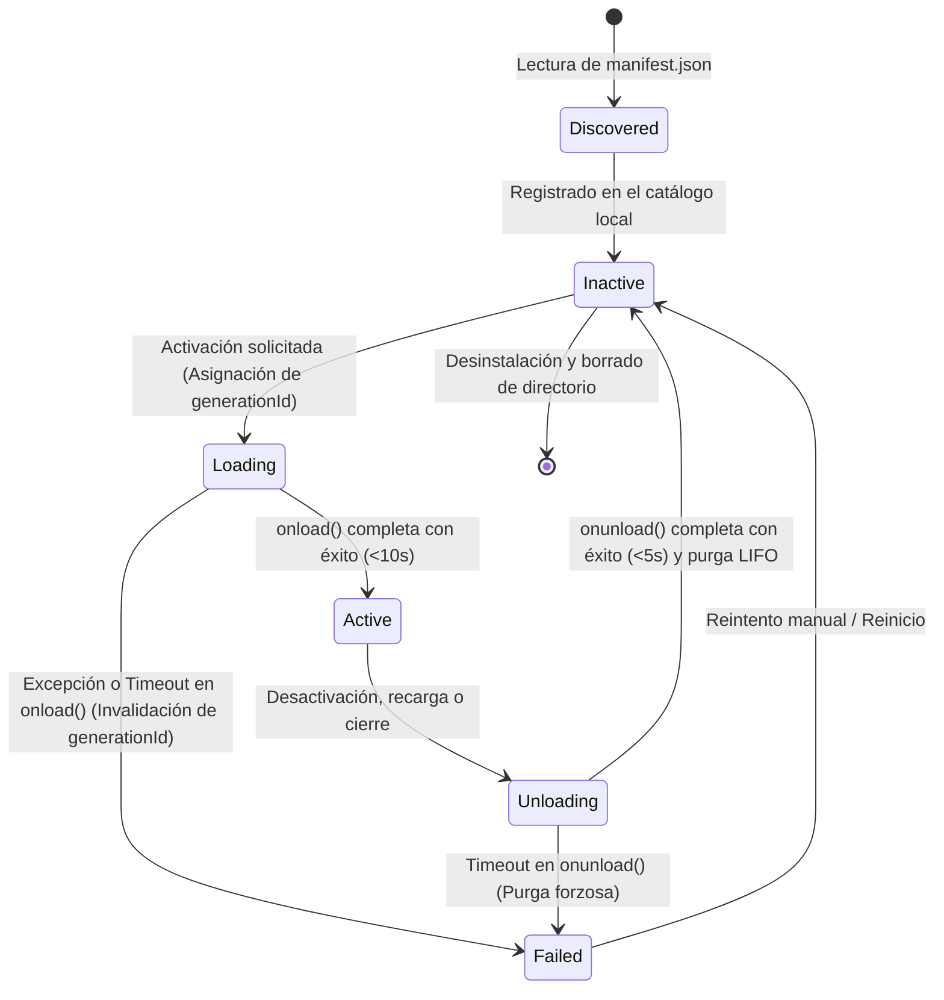
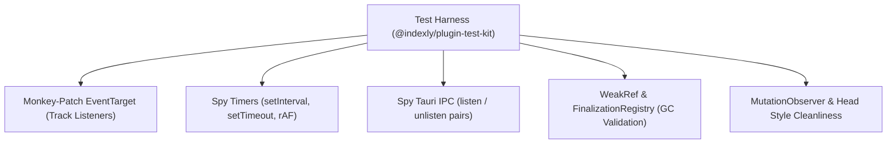

# Ciclo de Vida, Prevención de Fugas y Token de Generación

Este documento describe la máquina de estados, el protocolo de carga/descarga, la semántica realista de timeouts frente a las limitaciones de V8 y la instrumentación rigurosa del harness de pruebas contra fugas de memoria.

---

## 1. Máquina de Estados del Plugin



---

## 2. Semántica de Timeouts y Token de Generación

### 2.1 Limitaciones de V8 y Código Síncrono
En el modelo de concurrencia de JavaScript basado en un único hilo con bucle de eventos, **ningún temporizador ni interrupción externa de software puede abortar de forma segura un bucle síncrono infinito** (`while(true)`). 

Por tanto, el `PluginHost` adopta un enfoque realista:
1. **Medición de Bloqueo Síncrono:** Todas las fases de ejecución de plugins son medidas con `performance.now()`. Si una llamada síncrona retiene el hilo más de **250 ms**, se emite una alerta diagnóstica. Si supera 10 segundos continuos, el watchdog del sistema operativo alertará al usuario y forzará el Modo Seguro en el siguiente arranque.
2. **Promesas Asíncronas:** Para operaciones asíncronas (`onload()`, `onunload()`), el host establece una carrera (`Promise.race`) contra un temporizador interno:
   - `onload()`: 10 segundos.
   - `onunload()`: 5 segundos.

### 2.2 Token de Generación (`generationId`)
Para evitar que un plugin cuyo `onload()` sufrió un timeout intente mutar el host cuando finalmente resuelve tarde (problema del plugin zombi):
1. Cada ciclo de carga genera un número de versión `generationId` monótonamente creciente en el host.
2. La instancia del plugin recibe este `generationId`.
3. Todos los métodos de registro (`addCommand`, `registerView`, `registerEvent`, etc.) verifican:
   ```ts
   if (this._generationId !== host.getActiveGenerationId(this.manifest.id)) {
     console.warn(`[PluginHost] Intento de registro descartado: generationId obsoleto para ${this.manifest.id}`);
     return; // Descarte silencioso sin mutación de estado
   }
   ```
4. Al dispararse un timeout o al iniciar la descarga, el `generationId` del plugin se invalida de inmediato. Cualquier llamada posterior queda desarmada.

---

## 3. Atribución de Errores Globales

Cuando se produce un error no capturado en la aplicación, el host lo atribuye al plugin exacto mediante una estrategia triple:

1. **Virtual Source URLs:** Todo código evaluado por el loader inyecta al final:
   ```js
   //# sourceURL=indexly-plugin://${manifest.id}/main.js
   ```
2. **Stack Trace Parsing:** Los manejadores globales `window.onerror` y `window.onunhandledrejection` analizan el `error.stack`. Si la pila contiene `indexly-plugin://${manifest.id}/`, el error se adjudica inequívocamente a ese plugin.
3. **Pila de Contexto (`safeCall`):** Durante la invocación de callbacks registrados (eventos, atajos, comandos), el host establece `activePluginContext = pluginId` en un stack síncrono. Los callbacks diferidos capturan esta etiqueta para mantener la trazabilidad.

---

## 4. Test de Fugas con Instrumentación de Harness (`@indexly/plugin-test-kit`)

Para verificar de forma infalible la ausencia de fugas tras 100 ciclos de activación/desactivación, el harness instrumenta los puntos críticos del runtime:



### Protocolo de Validación:
1. **EventTarget Tracking:** Se interceptan `addEventListener` y `removeEventListener` registrando las referencias en un `Map<EventTarget, Set<{ type, listener, pluginId }>>`. Al finalizar el ciclo `onunload()`, el conjunto debe estar vacío.
2. **Timer Tracking:** Se contabilizan los IDs de `setInterval` y `setTimeout`. Ningún temporizador registrado por el plugin debe continuar activo tras `onunload()`.
3. **Tauri IPC Listeners:** Se verifica que todas las funciones de desuscripción devueltas por `@tauri-apps/api/event.listen` hayan sido invocadas.
4. **Limpieza del DOM:** Se comprueba que ningún elemento HTML huérfano ni etiqueta `<style data-plugin-id="...">` permanezca en el documento.
5. **Retención de Instancia (GC Check):** La instancia de la clase `Plugin` se envuelve en un `WeakRef`. Tras la descarga y la llamada forzada a `global.gc()`, el harness comprueba que el recolector de basura haya reclamado la instancia, demostrando que el host no retiene closures indebidas.
