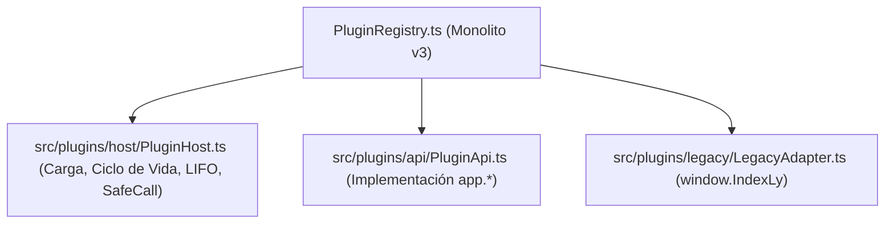

# Plan de Migración y Resolución de las 12 Deudas Técnicas

Este documento detalla la transición arquitectónica desde el motor Co-Kernel monolítico (`PluginRegistry.ts`, `window.IndexLy`) hacia la arquitectura modular de plugins v1 (`PluginHost`, `PluginApi`), resolviendo las 12 deudas técnicas vinculantes y garantizando grandfathering integral para extensiones existentes.

---

## 1. Desacoplamiento de `PluginRegistry.ts`

La lógica de `PluginRegistry.ts` (1.157 líneas) se distribuye en tres capas con responsabilidades independientes:

1. **`PluginHost.ts`:** Gestión del cargador CommonJS, mapa de instancias, `generationId`, cola LIFO de descarte (`disposables`), timeout de 10s/5s, envoltura `safeCall` y modo seguro.
2. **`PluginApi.ts`:** Implementación concreta de los módulos `library`, `search`, `workspace`, `native`, `storage`, `ui`, `commands`, `settings`, `importer`, `hub`.
3. **`LegacyAdapter.ts`:** Fachada retrocompatible que expone `window.IndexLy` delegando en `app.*` y emitiendo advertencias de deprecación.

---

## 2. Grandfathering de Extensiones Legacy (v1–v3)

Para no romper plugins existentes en el ecosistema (p. ej., ReadLy, Vistas o extensiones en `.js` sueltos):

1. **Archivos `.js` sueltos con cabecera:** Si el cargador detecta un archivo `.js` sin `manifest.json` pero con cabecera `/* IndexLy Plugin ... */`, el parser nativo en Rust extrae los metadatos y sintetiza un `PluginManifest` virtual en memoria con `schemaVersion: 0`.
2. **Normalización de campos:**
   - Si no existe `schemaVersion`, se fija en `0`.
   - Si declara `capabilities: string[]`, se asigna automáticamente a `permissions`.
   - Si no declara `minHostVersion`, se asume `"0.1.0"`.
3. **Puntos de Montaje Legacy:** Los métodos `IndexLy.register()`, `IndexLy.plugin()`, `IndexLy.addSection()`, `IndexLy.addCardAction()` y `IndexLy.pipeline.intercept()` continúan funcionando, vinculándose internamente al nuevo ciclo de vida del host.

---

## 3. Resolución de las 12 Deudas Técnicas Vinculantes

| # | Deuda Técnica | Causa Raíz en Código Previo | Solución Vinculante en v1 |
|---|---|---|---|
| 1 | Debounce de 25 ms sin cancelación de peticiones | `App.tsx` disparaba `setTimeout(25ms)` sin cancelar peticiones FTS5 previas en vuelo. | Introducción de `AbortController` y token de solicitud en vuelo que aborta transacciones concurrentes. |
| 2 | `ORDER BY file_size` textual en SQLite | En `db.rs` la columna era puramente `file_size TEXT` ("70 GB" < "8 GB"). | Nueva columna indexada `file_size_bytes INTEGER` para ordenación numérica exacta; texto preservado para display. |
| 3 | Sanitizador FTS5 rudimentario | En `db.rs` se eliminaban caracteres con `is_alphanumeric()`, rompiendo búsquedas complejas. | Tokenizador formal para FTS5 que respeta comillas dobles, comodines `*` y operadores sin arrojar syntax error. |
| 4 | `addSource` ignoraba claves camelCase | `MappingConfig` en `models.rs` esperaba snake_case (`title_key`), fallando deserialización. | Incorporación de `#[serde(rename_all = "camelCase")]` y alias en `models.rs`. |
| 5 | `insert_sources_batch` perdía `flags_json` | La consulta `INSERT` en `db.rs` omitía `flags_json` en inserciones masivas. | Sentencia `INSERT` actualizada para persistir `flags_json` en todas las operaciones por lotes. |
| 6 | Mapping CSV no aplicado en normalizador | `parse_csv_to_items` en `normalizer.rs` no aceptaba `MappingConfig`. | Función refactorizada para aceptar `Option<&MappingConfig>` y mapear columnas arbitrarias a `UnifiedItem`. |
| 7 | Import tabular `{k, v}` producía 0 items | `normalize_json_to_items` no reconocía el formato tabular fuera del sobre v2. | Detección automática de objetos `{ "k": [...], "v": [...] }` en cualquier nivel de archivo JSON. |
| 8 | `.torrent` generaba magnet sintético | Generaba un string ficticio `magnet:?xt=urn:btih:synthetic`. | Extracción e indexación real del info_hash SHA-1 de 40 caracteres desde el diccionario bencode `info`. |
| 9 | `Slot.tsx` con guard `dataset.rendered` | `dataset.rendered = 'true'` impedía re-renders y ciclos limpios de reactividad. | Reemplazo por hooks `useEffect` con referencias DOM limpias y funciones de desmontaje. |
| 10 | Vistas custom limpiaban el DOM en cada render | `el.innerHTML = ''` en cada ciclo de renderizado eliminaba el estado interno del plugin. | Preservación del nodo raíz provisto al plugin; el host sólo notifica cambios mediante callbacks. |
| 11 | Spotlight sin capacidades en `default.json` | `src-tauri/capabilities/default.json` sólo declaraba `"windows": ["main"]`. | Inclusión explícita de `"spotlight"` en la lista de ventanas con permisos de Tauri. |
| 12 | `ensure_bundled_plugins` con ruta hardcodeada | Ruta fija de desarrollo `c:/Users/david/...` en `plugins.rs`. | Resolución canónica multiplataforma mediante `app_handle.path().resource_dir()`. |

---

## 4. Migración de Persistencia

Los datos persistidos previamente en `IndexedDB` (`indexly_plugin_storage`) o `localStorage` con prefijo `plx_` se migran automáticamente hacia `<appDataDir>/plugins/<pluginId>/data.json` la primera vez que la extensión se inicializa bajo la API v1.
