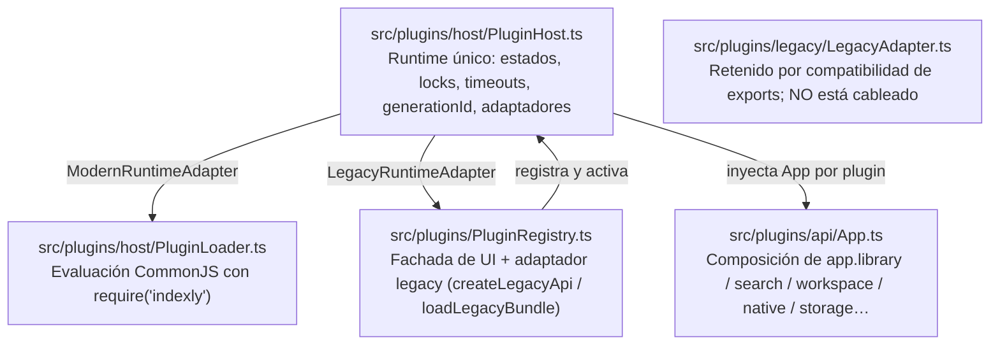

# Plan de Migración y Resolución de las 12 Deudas Técnicas

Este documento describe la transición desde el motor Co-Kernel monolítico (`PluginRegistry.ts`, `window.IndexLy`) hacia la arquitectura modular de plugins v1, el estado real de cada capa y el grandfathering de extensiones existentes.

> **Nota de honestidad documental:** este documento describe lo que el código hace hoy, no el diseño ideal. Cuando una capacidad no existe, se indica explícitamente.

---

## 1. Reparto de Responsabilidades (estado real)



1. **`PluginHost.ts` — único propietario del runtime.**
   - Máquina de estados explícita: `inactive → loading → active → unloading → inactive`, con `failed` como estado terminal de una activación fallida.
   - Serializa `enable`/`disable`/`reload` por plugin (`_locks`); plugins distintos cargan en paralelo.
   - Asigna `generationId` por activación, aplica timeouts (`onload` 10 s, `onunload` 5 s), ejecuta hooks críticos con `safeCallCritical` y purga recursos LIFO, eventos y estilos.
   - Selecciona el runtime mediante adaptadores registrados (`ModernRuntimeAdapter`, adaptador legacy).

2. **`PluginRegistry.ts` — fachada de UI y compatibilidad.**
   - Mantiene secciones, chips, card actions, overrides y settings para React.
   - **No ejecuta bundles modernos**: delega en `pluginHost.registerPlugin()` + `enablePlugin()`.
   - Implementa el adaptador legacy (`createLegacyApi()` y `loadLegacyBundle()`), que el host invoca solo cuando el manifiesto se detecta como legacy.
   - `teardownPlugin()` limpia únicamente registros de UI; el ciclo de vida pertenece al host.

3. **`src/plugins/api/App.ts` + módulos por dominio.**
   - No existe un archivo `PluginApi.ts`. `createAppInstance()` compone `HostLibraryApi`, `HostSearchApi`, `HostWorkspaceApi`, `HostCommandsApi`, `HostSettingsApi`, `HostImporterApi`, `HostHubApi`, `ScopedStorageApi`, `createNativeApi()` y `HostEventsApi`.
   - Cada plugin recibe su propia instancia con `pluginId` para storage y settings aislados.

4. **`src/plugins/legacy/LegacyAdapter.ts` — código retenido, no activo.**
   - `LegacyCoKernelAdapter` e `installLegacyAdapter()` siguen exportados desde `src/plugins/index.ts`, pero **ningún punto de la aplicación los instancia**.
   - El adaptador legacy realmente en uso es el de `PluginRegistry` (`window.IndexLy` + `IndexLy.register/plugin`).
   - Se conserva para no romper imports públicos; no debe usarse como referencia de la ruta activa.

---

## 2. Grandfathering de Extensiones Legacy (v1–v3)

La detección de runtime es **explícita por manifiesto**, nunca por búsqueda de cadenas en el bundle:

```ts
// src/plugins/host/PluginHost.ts
export function detectPluginRuntime(rawManifest: unknown): 'modern' | 'legacy' {
  // moderno si declara schemaVersion numérico o minHostVersion no vacío
  // legacy en caso contrario
}
```

1. **Archivos `.js` sueltos con cabecera:** `parse_plugin_header()` en Rust reconoce `/* IndexLy Plugin ... */`, extrae `id`, `name`, `version`, `description` y `permissions`, y sintetiza un `PluginManifest` con `schema_version: None` y `min_host_version: None`. Ese manifiesto se clasifica como legacy.
2. **Normalización en el frontend (`validateAndNormalizeManifest`):**
   - Si no existe `schemaVersion`, se normaliza a **`1`** (no a `0`). La detección legacy ocurre antes, sobre el manifiesto crudo.
   - Si no declara `minHostVersion`, se asume `"0.1.0"`.
   - `capabilities` **no** se copia automáticamente a `permissions`; solo se leen `permissions`.
   - El `id` sin notación de dominio inverso se acepta para plugins legacy incorporados.
3. **Puntos de montaje legacy:** `IndexLy.register()` e `IndexLy.plugin()` siguen funcionando dentro del ciclo de vida del host. `addSection`, `addCardAction` y `pipeline.intercept` existen en `LegacyAdapter.ts`, pero **no están cableados** en la ruta legacy activa; un plugin que dependa de ellos no debe asumir que funcionan.
4. **Instalaciones y actualizaciones:**
   - Una instalación nueva se guarda con `enabled = false`.
   - Una actualización conserva el `enabled` previo.
   - Si aparecen permisos nuevos, el plugin queda desactivado y los permisos se registran en `pendingPermissions` hasta que el usuario lo active explícitamente.

---

## 3. Resolución de las 12 Deudas Técnicas Vinculantes

| # | Deuda Técnica | Causa Raíz en Código Previo | Solución en v1 |
|---|---|---|---|
| 1 | Debounce sin cancelación de peticiones | `App.tsx` disparaba búsquedas con `setTimeout` sin cancelar peticiones FTS5 previas en vuelo. | Debounce cancelable (100 ms) con `AbortController` y `searchAbortControllerRef`. |
| 2 | `ORDER BY file_size` textual en SQLite | En `db.rs` la columna era puramente `file_size TEXT` ("70 GB" < "8 GB"). | Columna indexada `file_size_bytes INTEGER` para ordenación numérica exacta; texto preservado para display. |
| 3 | Sanitizador FTS5 rudimentario | En `db.rs` se eliminaban caracteres con `is_alphanumeric()`, rompiendo búsquedas complejas. | Tokenizador formal para FTS5 que respeta comillas dobles, comodines `*` y operadores sin arrojar syntax error. |
| 4 | `addSource` ignoraba claves camelCase | `MappingConfig` en `models.rs` esperaba snake_case (`title_key`), fallando deserialización. | Incorporación de `#[serde(rename_all = "camelCase")]` y alias en `models.rs`. |
| 5 | `insert_sources_batch` perdía `flags_json` | La consulta `INSERT` en `db.rs` omitía `flags_json` en inserciones masivas. | Sentencia `INSERT` actualizada para persistir `flags_json` en todas las operaciones por lotes. |
| 6 | Mapping CSV no aplicado en normalizador | `parse_csv_to_items` en `normalizer.rs` no aceptaba `MappingConfig`. | Función refactorizada para aceptar `Option<&MappingConfig>` y mapear columnas arbitrarias a `UnifiedItem`. |
| 7 | Import tabular `{k, v}` producía 0 items | `normalize_json_to_items` no reconocía el formato tabular fuera del sobre v2. | Detección automática de objetos `{ "k": [...], "v": [...] }` en cualquier nivel de archivo JSON. |
| 8 | `.torrent` generaba magnet sintético | Generaba un string ficticio `magnet:?xt=urn:btih:synthetic`. | Extracción e indexación real del info_hash SHA-1 de 40 caracteres desde el diccionario bencode `info`. |
| 9 | `Slot.tsx` con guard `dataset.rendered` | `dataset.rendered = 'true'` impedía re-renders y ciclos limpios de reactividad. | Reemplazo por hooks `useEffect` con referencias DOM limpias y funciones de desmontaje. |
| 10 | Vistas custom limpiaban el DOM en cada render | `el.innerHTML = ''` en cada ciclo de renderizado eliminaba el estado interno del plugin. | Preservación del nodo raíz provisto al plugin; el host sólo notifica cambios mediante callbacks. |
| 11 | Spotlight sin capacidades en `default.json` | `src-tauri/capabilities/default.json` sólo declaraba `"windows": ["main"]`. | Inclusión explícita de `"main"` y `"spotlight"` en la lista de ventanas con permisos de Tauri. |
| 12 | `ensure_bundled_plugins` con ruta hardcodeada | Ruta fija de desarrollo `c:/Users/david/...` en `plugins.rs`. | Descubrimiento por `INDEXLY_BUNDLED_PLUGINS_DIR` y rutas relativas (`plugins`, `../plugins`, `../public/plugins`). **No** usa `resource_dir()` todavía. |

---

## 4. Migración de Persistencia (estado real)

No existe una migración automática a `<appDataDir>/plugins/<pluginId>/data.json`.

El almacenamiento real de `app.storage` es:

1. **Tauri / escritorio:** comandos IPC `plugin_storage_read_text`, `plugin_storage_write_text` y `plugin_storage_remove`, respaldados por la tabla SQLite `plugin_storage` (`plugin_id`, `key`, `val`, `updated_at`). Es una única base de datos, no un archivo JSON por plugin.
2. **Fallback web/tests:** `Map` en memoria y `localStorage` con la clave `indexly_storage:<pluginId>:<filename>`.

Consecuencias para plugins antiguos:

- Los datos guardados con la clave histórica `plx_<pluginId>_<key>` **no se migran automáticamente**. `PluginRegistry` todavía los lee como fallback de compatibilidad, pero el código nuevo debe usar `app.storage`.
- No hay deduplicación ni conversión de `IndexedDB` a SQLite implementada.
- Un plugin que necesite migrar datos debe hacerlo explícitamente en su `onload()`, leyendo la fuente antigua y escribiendo con `app.storage.writeText()` / `writeJson()`.

---

## 5. Qué falta para completar la migración

Estas son limitaciones conocidas, no promesas:

- `LegacyAdapter.ts` sigue siendo código muerto; conviene eliminarlo o conectarlo en una decisión posterior.
- `IndexLy.addSection`, `IndexLy.addCardAction` y `pipeline.intercept` no están disponibles en la ruta legacy activa.
- No hay migración automática de `localStorage`/`IndexedDB` a SQLite.
- No hay CI; las comprobaciones son locales (`npm run build`, `npm test`, `cargo test --lib`).
