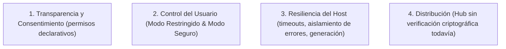

# Postura de Seguridad y Transparencia

Este documento define la postura oficial de seguridad para el ecosistema de plugins de IndexLy Desktop.

> **Nota de honestidad documental:** aquí se describe lo que el código implementa hoy. Las capacidades que no existen se marcan como tales.

---

## 1. Realismo Técnico vs Ilusión de Seguridad

En aplicaciones de escritorio que permiten ampliar capacidades con código de terceros (Obsidian, Raycast, VS Code, NeoVim), aislar extensiones en cajas de arena impenetrables resulta incompatible con el acceso al sistema de archivos, la ejecución de binarios nativos y la indexación local sin latencia IPC.

**Nuestra postura es transparente:**

- **Ejecución in-process:** los plugins se ejecutan en el mismo contexto de aplicación que el host, con acceso a `window`, `document` y a las APIs expuestas.
- **Sin sandbox real:** no hay proceso separado, `Worker`, iframe aislado ni filtro de llamadas por plugin.
- **Sin permisos de bloqueo ficticios:** el campo `permissions` es informativo. No impide a un plugin leer archivos, ejecutar procesos o acceder a la red. No existe un cortafuegos interno por permiso.
- **Consecuencia:** instalar y activar un plugin equivale a ejecutar código de terceros con los privilegios de la aplicación.

---

## 2. Los Cuatro Pilares (con su alcance real)

### 2.1 Transparencia y Consentimiento Informado

- El campo `permissions` en `manifest.json` **no es un mecanismo de bloqueo en runtime**; es una declaración del desarrollador para informar antes de instalar.
- La interfaz de instalación y el gestor de plugins muestran los permisos declarados. `PluginModal` incluye además un aviso explícito de que los permisos no constituyen un sandbox.
- **Instalaciones nuevas:** `PluginManager::install_plugin` fuerza `enabled = false`. El plugin no se ejecuta hasta que el usuario lo activa.
- **Actualizaciones:** se conserva el estado `enabled` previo. Si la nueva versión declara permisos que no estaban en la anterior:
  - el plugin se desactiva (`enabled = false`), y
  - los permisos añadidos se guardan en `pendingPermissions`.
- **Activación explícita:** al activar el plugin, `toggle_plugin` limpia `pendingPermissions`. Ese clic del usuario es el consentimiento registrado.
- Los permisos son declarativos: un plugin puede solicitar `fs:read` y seguir usando cualquier otra API disponible. La lista sirve para transparencia y para forzar una revisión, no para limitar llamadas.

### 2.2 Control del Usuario

- **Activación Explícita:** ningún plugin nuevo arranca activo. Las actualizaciones sin permisos nuevos mantienen el estado anterior para no interrumpir al usuario.
- **Modo Restringido (Restricted Mode):** interruptor global; `PluginHost.enablePlugin()` rechaza cargas mientras esté activo.
- **Modo Seguro (Safe Mode):** si la app detecta cierres sucios consecutivos, arranca en modo restringido. La lógica vive en `src/plugins/host/SafeMode.ts` y se evalúa al construir el host.

### 2.3 Resiliencia del Host

- **Estados y serialización:** `PluginHost` usa estados explícitos (`inactive`, `loading`, `active`, `unloading`, `failed`) y serializa las operaciones de un mismo plugin para evitar dobles instancias y listeners duplicados.
- **`safeCall` vs `safeCallCritical`:**
  - `safeCall()` aísla callbacks ordinarios: registra el error y devuelve `undefined`.
  - `safeCallCritical()` se usa en `onload`/`onunload`: registra el error **y lo relanza** para que la activación se marque como `failed` y se limpien los recursos parciales.
- **Token de generación:** cada activación recibe un `generationId`. Si `onload()` termina después de un timeout o de una descarga, el host detecta la invalidación, no marca el plugin como activo y ejecuta una limpieza adicional idempotente.
  - **Limitación:** las APIs de registro no comprueban el `generationId` en cada llamada. La protección es de ciclo de vida, no un filtro por operación.
- **Timeouts:** `onload` 10 s y `onunload` 5 s. Un `onunload` que excede el límite provoca purga forzosa LIFO; no se espera indefinidamente.
- **Colecciones privadas:** el host usa campos `private` de TypeScript y `Map`s internos. **No** usa campos `#private` de JavaScript, por lo que un plugin decidido puede inspeccionarlos en runtime. Esto es aislamiento de diseño, no una frontera de seguridad.
- **Sin `Object.freeze`:** se evita por coste en V8 y fragilidad; no se presenta como mecanismo de seguridad.

### 2.4 Distribución e Integridad

- Los manifiestos admiten `hash`, `signature` y `sourceCommit`, pero **el host no verifica firmas ni hashes** al instalar desde el Hub. Son metadatos, no una garantía criptográfica.
- **No existe hoy un escáner estático automatizado** en el Hub ni en la app. La revisión de código es manual/comunitaria.
- La instalación desde el Hub descarga el paquete y lo entrega a `PluginManager`; no hay paso de auditoría automática.

---

## 3. Recomendaciones para el Usuario

1. Instala plugins de fuentes que puedas auditar.
2. Revisa los permisos declarados, sabiendo que son informativos.
3. Mantén el Modo Restringido activo si no necesitas extensiones.
4. Trata cualquier plugin como código con los mismos privilegios que IndexLy Desktop.
