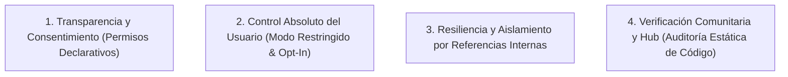

# Postura de Seguridad y Transparencia

Este documento define la postura oficial de seguridad para el ecosistema de plugins de IndexLy Desktop.

---

## 1. Realismo Técnico vs Ilusión de Seguridad

En aplicaciones de escritorio avanzadas que permiten a los usuarios ampliar sus capacidades con código de terceros (como Obsidian, Raycast, VS Code o NeoVim), aislar extensiones en cajas de arena impenetrables (sandboxes de navegador o procesos completamente aislados) resulta incompatible con la necesidad de acceder al sistema de archivos local, ejecutar binarios nativos, indexar bases de datos masivas y ofrecer una experiencia de usuario fluida sin latencia IPC interproceso.

**Nuestra postura es transparente:**
- **Ejecución in-process:** Los plugins se ejecutan en el mismo contexto de aplicación que el host.
- **Sin permisos de bloqueo ficticios:** No fingimos contar con un cortafuegos interno que impida a un plugin malicioso acceder a la memoria si se ejecuta en el mismo proceso. Los sistemas que simulan permisos restrictivos sin aislamiento a nivel de hardware o proceso generan una peligrosa falsa sensación de seguridad.

---

## 2. Los Cuatro Pilares de Seguridad de IndexLy

### 2.1 Transparencia y Consentimiento Informado
- El campo `permissions` en `manifest.json` no es un mecanismo de bloqueo en runtime; es una declaración jurada del desarrollador para informar al usuario antes de la instalación.
- La interfaz de instalación muestra en lenguaje claro el significado de cada permiso (`fs:read` = "Leer archivos locales", `process:spawn` = "Ejecutar programas", `db:write` = "Modificar la base de datos local").
- Si una actualización introduce nuevos permisos, se solicita confirmación explícita al usuario antes de aplicarla.

### 2.2 Control Absoluto del Usuario
- **Activación Explícita:** Ningún plugin se activa automáticamente al instalarse o actualizarse.
- **Modo Restringido (Restricted Mode):** Interruptor global que apaga de inmediato la ejecución de cualquier código de terceros. Permite arrancar la app en un estado 100% oficial para descartar problemas o depurar.
- **Recuperación Automática de Arranque (Safe Mode):** Si IndexLy detecta que la aplicación no pudo iniciar limpiamente en 2 intentos consecutivos, arranca de forma forzosa en Modo Restringido.

### 2.3 Resiliencia y Aislamiento por Referencias Internas
- **Sin `Object.freeze`:** Se prescinde de `Object.freeze` por su penalización en V8 y fragilidad. El kernel del host gestiona sus registros, comandos y despachos mediante colecciones privadas (`#privateMaps`) inaccesibles para el plugin.
- **Token de Generación:** Cada activación invalida las llamadas asíncronas tardías de instancias anteriores, impidiendo mutaciones zombis.
- **Envoltura `safeCall`:** Cada callback de plugin está envuelto en `safeCall()`. Un error o excepción no capturada en un plugin nunca destruye el hilo de la interfaz ni cuelga el host.
- **Límites de tiempo asíncronos:** Límites de tiempo (`onload` 10s, `onunload` 5s) impiden que un plugin mantenga congelado el arranque o cierre del programa.

### 2.4 Auditoría, Integridad y Hub Abierto
- **Integridad Verificable:** Cada manifiesto incluye `hash` (SHA-256 de `main.js`), `signature` (Ed25519) y `sourceCommit` (enlace al commit público auditado).
- **Escaneo Estático Automatizado:** El Hub analiza el código fuente en búsqueda de patrones peligrosos (ofuscación excesiva, llamadas dinámicas a URLs no auditadas o intentos de manipulación de credenciales).
