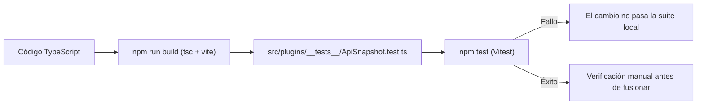

# Contrato de Estabilidad e Inmutabilidad de la API

La estabilidad de la API de plugins de IndexLy Desktop es un compromiso fundacional de ingeniería. Una vez que una interfaz se publica en la serie `1.x`, se garantiza que ningún plugin existente dejará de funcionar por incompatibilidades arbitrarias introducidas por el host.

---

## 1. Reglas SemVer para la Plataforma

1. **`apiVersion: "1.0.0"`:** El número de versión de la API de plugins evoluciona de forma independiente de la versión de la aplicación de escritorio (`version`).
2. **Cambios dentro de `1.x`:** Son exclusivamente **aditivos**. Se pueden incorporar nuevos métodos a `app.*`, nuevos campos opcionales o nuevos eventos, pero nunca renombrar ni eliminar signaturas preexistentes.
3. **Prohibición de Breaking Changes:** Cualquier cambio que rompa la compatibilidad de tipos o de ejecución está vetado en `1.x`.

---

## 2. Política Formal de Deprecación

Si una interfaz, clase o propiedad requiere ser sustituida por un diseño superior:

1. **Marca JSDoc:** Se anota con `@deprecated` indicando la alternativa canónica y el hito programado.
2. **Ventana de 12 Meses:** La funcionalidad deprecada se mantiene plenamente operativa durante un mínimo de 12 meses antes de cualquier consideración de retiro en una versión mayor futura (`2.0.0`).
3. **Aviso Único por Sesión:** El host registra una advertencia en la consola de depuración como máximo **una vez por sesión**, evitando saturar los registros del desarrollador.

---

## 3. Verificación de Compatibilidad (estado real del repositorio)

**No existe hoy `@microsoft/api-extractor` ni un pipeline de CI configurado.** El repositorio no contiene `.github/`, no hay un `api/indexly.api.md` generado y `package.json` no incluye la dependencia. La verificación real es:

- `ApiSnapshot.test.ts` comprueba que las clases, errores y módulos públicos siguen exportándose.
- `docs/plugin-api/golden-contract.api.md` es la referencia documental del contrato.
- La comprobación **no bloquea Pull Requests automáticamente** porque no hay CI. Es una salvaguarda local que debe ejecutarse manualmente con `npm test`.
- Si en el futuro se añade CI, el paso mínimo recomendado es `npm run build && npm test && cargo test --lib`.

---

## 4. Harness de Pruebas Interno

No se publica actualmente un paquete `@indexly/plugin-test-kit`. El repositorio incluye utilidades internas de prueba en `src/plugins/__tests__/`:

- `PluginHost.test.ts`: ciclo de vida, timeouts, hooks que lanzan y activaciones concurrentes.
- `SafeCall.test.ts`: aislamiento de callbacks y propagación de errores críticos.
- `SamplePlugins.test.ts`: carga de plugins de ejemplo reales desde disco.
- `ApiSnapshot.test.ts`: superficie pública exportada.

Estas pruebas se ejecutan con `npm test` y no sustituyen a una suite de conformidad publicada.

---

## 5. Ejemplos Versionados de Referencia

El repositorio incluye plugins de ejemplo que la suite local carga desde disco:

1. **`hello-command`:** comandos y avisos de notificación.
2. **`custom-view-react`:** vista interactiva montada en un `WorkspaceLeaf`.
3. **`importer-csv`:** importación de CSV mediante `app.importer`.
4. **`scratchpad-notes`:** persistencia, portapapeles y limpieza de vistas.

`SamplePlugins.test.ts` los ejecuta con Vitest. No hay un pipeline de CI que los ejecute automáticamente antes de fusionar.
