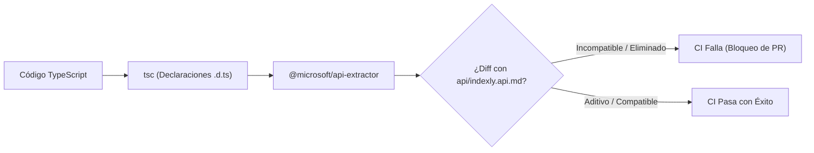

# Contrato de Estabilidad e Inmutabilidad de la API

La estabilidad de la API de plugins de IndexLy Desktop es un compromiso fundacional de ingeniería. Una vez que una interfaz se publica en la serie `1.x`, se garantiza que ningún plugin existente dejará de funcionar por incompatibilidades arbitrarias introducidas por el host.

---

## 1. Reglas SemVer para la Plataforma

1. **`apiVersion: "1.0.0"`:** El número de versión de la API de plugins evoluciona de forma independiente de la versión de la aplicación de escritorio (`version`).
2. **Cambios dentro de `1.x`:** Son exclusivamente **aditivos**. Se pueden incorporar nuevos métodos a `app.*`, nuevos campos opcionales o nuevos eventos, pero nunca renombrar ni eliminar signaturas preexistentes.
3. **Prohibición de Breaking Changes:** Cualquier cambio que rompa la compatibilidad de tipos o de ejecución está vetado en `1.x`.

---

## 2. Política Formal de Deprecación

Si una interfaz, clase o propiedad requiere ser sustituida por un diseño superior:

1. **Marca JSDoc:** Se anota con `@deprecated` indicando la alternativa canónica y el hito programado.
2. **Ventana de 12 Meses:** La funcionalidad deprecada se mantiene plenamente operativa durante un mínimo de 12 meses antes de cualquier consideración de retiro en una versión mayor futura (`2.0.0`).
3. **Aviso Único por Sesión:** El host registra una advertencia en la consola de depuración como máximo **una vez por sesión**, evitando saturar los registros del desarrollador.

---

## 3. Verificación de Compatibilidad en CI con `@microsoft/api-extractor`

El repositorio utiliza `@microsoft/api-extractor` para capturar la superficie pública de tipos en el archivo `api/indexly.api.md`.



- Cada Pull Request ejecuta una comprobación contra el snapshot de referencia.
- Si se detecta la modificación de una propiedad existente, la supresión de un método o una alteración de tipo que no sea estrictamente compatible hacia atrás, el flujo de integración continua **falla inmediatamente**.

---

## 4. Suite de Conformidad `@indexly/plugin-test-kit`

Para apoyar a los desarrolladores del ecosistema en la verificación rigurosa de sus extensiones, se distribuye el paquete `@indexly/plugin-test-kit`:

```ts
import { testPlugin } from '@indexly/plugin-test-kit';
import MiPlugin from './src/main';

testPlugin({
  pluginClass: MiPlugin,
  manifestPath: './manifest.json',
  leakTestCycles: 100,
  timeoutThresholdMs: 500,
});
```

El test-kit verifica automáticamente:
1. Validez formal de `manifest.json` contra el esquema JSON v1.
2. Ausencia de fugas de memoria en 100 ciclos de `onload()` / `onunload()`.
3. Idempotencia y resolución de promesas dentro de los límites de tiempo (10s / 5s).
4. Tipado estricto contra `indexly.d.ts`.

---

## 5. Ejemplos Versionados de Referencia

El repositorio incluye 3 plugins de prueba representativos mantenidos como suite de integración continua:

1. **`hello-command`:** Ejemplo mínimo en JavaScript / TypeScript plano que añade comandos y avisos de notificación.
2. **`custom-view-react`:** Ejemplo avanzado que monta componentes interactivos de React 19 dentro de un `WorkspaceLeaf`.
3. **`importer-csv`:** Extensión del motor de importación que procesa archivos CSV complejos mediante `app.importer`.

Cualquier cambio propuesto en el código de IndexLy Desktop debe compilar y ejecutar estos tres plugins con éxito antes de ser fusionado.
